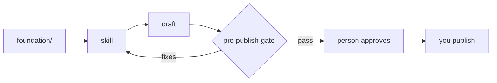

# gtm-os-starter

A forkable marketing system where every draft starts from your company's facts and stops at a person before it ships.

## The problem

AI drafts for marketing forget who you sell to. They drift off voice, and they fill gaps with numbers nobody can source. Pasting the same context into every prompt works for one person on one day. It breaks the first time someone edits the positioning and half the team keeps the old version.

## What you get

Your ICP, positioning, voice and metric definitions live in one `foundation/` folder. Eight skills read from it before they write anything. A pre-publish gate checks every draft against your voice rules and your banned claims, and nothing goes out until a person approves it.

The repo ships filled in for Northwind Rentals, a fictional company that sells resident-communication software to apartment operators. Swap its files for yours and the skills keep working.

## How it works



Skills load only the foundation files they list under Inputs. The gate returns pass, or fixes with line numbers that go back to the skill. Publishing stays a human step.

## Install

```bash
git clone https://github.com/rokoruwa/gtm-os-starter.git && cd gtm-os-starter && ./setup.sh
```

You need git and [Bun](https://bun.sh) 1.1 or later. setup.sh copies `.env.example` to `.env`, creates `outputs/`, and runs the test suite. It makes no network calls.

## Setup

1. Read one run in `examples/` so you know what good output looks like.
2. Replace each file in `foundation/` with your company's version. [docs/adapting.md](docs/adapting.md) covers them in order.
3. Run `bun test`. The validators name any file that's missing a section, a source or a load header.
4. Open the repo in Claude Code or another agent that reads `.claude/skills/`, then run a skill such as `/icp-fit`.

## Skills

| Skill | Category | Reads from foundation/ | Gives you |
|---|---|---|---|
| [icp-fit](.claude/skills/icp-fit/SKILL.md) | Know the market | icp.md, icp-list.csv, personas.md | A fit score with the reason for every point |
| [positioning](.claude/skills/positioning/SKILL.md) | Know the market | company.md, competitors.md, personas.md | A six-step positioning draft with claims tagged |
| [angle-finder](.claude/skills/angle-finder/SKILL.md) | Create | positioning.md, competitors.md | Six angles away from the consensus take |
| [linkedin-post](.claude/skills/linkedin-post/SKILL.md) | Create | voice.md, do-not-say.md, positioning.md | A post draft that has already been through the gate |
| [founder-email](.claude/skills/founder-email/SKILL.md) | Create | voice.md, do-not-say.md, icp-list.csv | A one-to-one draft the founder sends personally |
| [pre-publish-gate](.claude/skills/pre-publish-gate/SKILL.md) | Review | voice.md, do-not-say.md | Pass, or fixes with line numbers |
| [scorecard](.claude/skills/scorecard/SKILL.md) | Measure | metrics.md | A scorecard where unsourced values read TBD |
| [post-performance](.claude/skills/post-performance/SKILL.md) | Measure | metrics.md, voice.md | Ranked posts and the patterns the top ones share |

Skills sit in flat folders under `.claude/skills/`. The category lives in each skill's frontmatter as `metadata.category`.

## Trust

**What it touches.** Files in this repo. Skills read `foundation/` and write to `outputs/`, which git ignores. No connector is configured out of the box.

**Where credentials live.** In your own `.env`, which git ignores, or in your agent host's secret store. `.env.example` lists variable names with no values.

**What it never does.** It never sends email, posts to social, writes to a CRM or spends money without a person approving that exact action. `.claude/settings.json` denies send, publish, schedule and CRM-write tools by default, and blocks reads of `.env`. There's no telemetry.

## Governance

- **Drafts, not decisions.** Skills write files. People approve and publish.
- **TBD beats a guess.** A metric without a source in `foundation/metrics.md` prints as TBD. The `no-invented-numbers` test fails any example that breaks this.
- **Claims carry tags.** Positioning work marks each claim as Fact, Inference or Unknown, so a reviewer knows what to check.
- **External copy loads the rules.** The `validate-skills` test fails any skill marked `external-copy` that doesn't load both `voice.md` and `do-not-say.md`.

[docs/governance.md](docs/governance.md) covers the approval flow and how to add a gate of your own.

## Maintenance

`bun test` runs four validators: foundation structure, skill structure, voice lint and invented numbers. CI runs the same tests and a [gitleaks](https://github.com/gitleaks/gitleaks) secret scan on every push and pull request. Changes are logged in [CHANGELOG.md](CHANGELOG.md) using semantic versioning.

Issues and pull requests are welcome. Keep examples fictional, and run `bun test` before you open a pull request.

## License

MIT. See [LICENSE](LICENSE).
